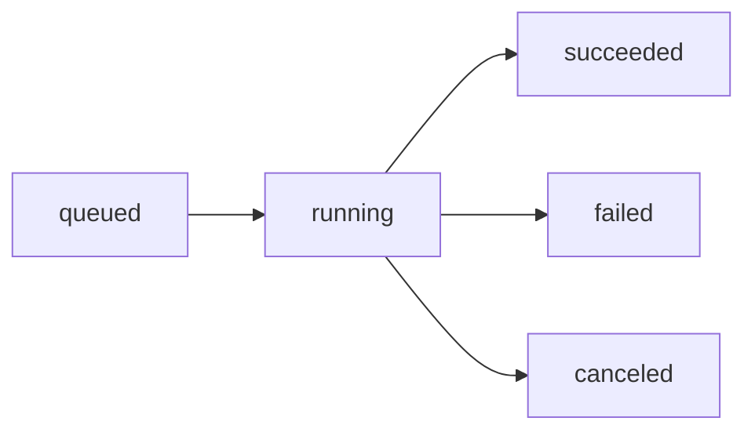

<Info>
**Type:** Read · **Required scope:** `decks:read` · **Cost:** Free
</Info>

## Parameters

<ParamField path="job_id" type="string" required>
  The job ID returned by [`create_deck`](/tools/create-deck) or [`fill_templates`](/tools/fill-templates).
</ParamField>

## Response

Returns the job object, the same shape as [`create_deck`](/tools/create-deck#response).

<ResponseField name="status" type="string">
  One of `queued`, `running`, `succeeded`, `failed`, `canceled`.
</ResponseField>
<ResponseField name="kind" type="string">
  `generate` ([`create_deck`](/tools/create-deck)) or `fill_templates` ([`fill_templates`](/tools/fill-templates)).
</ResponseField>
<ResponseField name="progress" type="object">
  Empty (`{}`) until the job starts. See [Progress fields](#progress-fields).
</ResponseField>
<ResponseField name="credits_charged" type="integer | null">
  Final credits charged once settled; refunded to `0` on failure or cancel.
</ResponseField>
<ResponseField name="error" type="object | null">
  Why the job (or an attempt of it) failed: `message`, the `stage` it failed in, and the `attempt`.
</ResponseField>
<ResponseField name="enterprise" type="boolean">
  `true` when the job runs with [enterprise data handling](/authentication#enterprise-data-handling).
</ResponseField>
<ResponseField name="library" type="object">
  `fill_templates` jobs only: the library `deck_id` and `exclude_member_ids`, or the `template_ids`, that the job fills.
</ResponseField>

<Expandable title="Example response (running create_deck job)">
```json
{
  "id": "3f6c2a1e-8b4d-4c7a-9e21-5d0f7b9a1c34",
  "kind": "generate",
  "status": "running",
  "prompt": "10-slide investor pitch...",
  "master_id": null,
  "master": "Professional Blue (Decky default)",
  "slides_requested": 10,
  "credits_reserved": 100,
  "credits_charged": null,
  "progress": {
    "stage": "generating_slides",
    "slides_done": 4,
    "target_slides": 10,
    "library_slides": 1
  },
  "error": null,
  "created_at": "2026-06-23T10:00:00Z",
  "finished_at": null,
  "enterprise": false
}
```
</Expandable>

## Progress fields [#progress-fields]

| Field | When | Meaning |
| --- | --- | --- |
| `stage` | Once running | `loading_template`, `generating_slides` (`create_deck`) or `filling_templates` (`fill_templates`), `finalizing`, `rendering_previews`, `done` |
| `slides_done` | Once running | Slides finished so far. When the job succeeds, the number of slides in the deck. |
| `target_slides` | Once running | Slides requested (for `fill_templates`, the most the deck may have) |
| `library_slides` | When any slide comes from the library | How many of `slides_done` were built from library templates. They cost 1 credit each. |
| `detail` | `fill_templates` | The current step, such as `planning the storyline` or `filling the slides` |
| `report` | `fill_templates`, once the slides are filled | What was filled, skipped, and left to confirm. See [below](#fill-templates-report). |
| `preview_slides` | `succeeded` | How many slides have a rendered preview image. The [deck card](/interactive-cards#deck-card) shows them. |
| `attributions` | `succeeded`, when present | Credit lines for third-party assets in the deck, such as `"Logos by Logo.dev"`. Pass them on to the user with the deck. |

### fill_templates report [#fill-templates-report]

For `fill_templates` jobs, `progress.report` says what Decky did with the material. Pass the placeholders and gaps on to the user: they are the facts to confirm or supply.

| Field | Meaning |
| --- | --- |
| `deck` | The library deck's title (deck fills only) |
| `slides` | Each slide built: `slide` number, its new `title`, and the library `template` (title) and `template_id` it came from |
| `skipped` | Slides that could not be filled, with a `reason`. For example, `no usable chart data (…)` for a chart slide without real data in the material |
| `placeholders` | Visible `[… — to confirm]` (or `[TBC]`) placeholders in the deck, as `slide N <slot>: <value>` |
| `gaps` | Facts the deck needs that the material did not give |
| `dropped` | Deck slides left out of the storyline, with a `reason` (deck fills only) |
| `kept_sample_pictures` | Picture slots that kept the template's sample picture. Swap them for your own in PowerPoint. |

<Expandable title="Example response (finished fill_templates job)">
```json
{
  "id": "8b0e6d2c-41f7-4a9b-b3e5-7c1d9f2a6e40",
  "kind": "fill_templates",
  "status": "succeeded",
  "prompt": "Q3 board review for Maven Labs...",
  "master_id": "650c4d7c-dd61-53f1-8f04-5dcb45b6d6cd",
  "master": "Graphite (Decky built-in)",
  "slides_requested": 12,
  "credits_reserved": 12,
  "credits_charged": 11,
  "progress": {
    "stage": "done",
    "slides_done": 11,
    "target_slides": 12,
    "detail": "filling the slides",
    "library_slides": 11,
    "preview_slides": 11,
    "report": {
      "deck": "Board strategy review",
      "slides": [
        { "slide": 1, "title": "Q3 board review", "template": "Title", "template_id": "e1f4…" },
        { "slide": 2, "title": "Revenue up 17% on Q2", "template": "KPI overview with trend", "template_id": "5d2f…" }
      ],
      "skipped": [
        { "title": "Cash runway", "reason": "no usable chart data (…)" }
      ],
      "placeholders": ["slide 2 kpis[3].value: [€ m — to confirm]"],
      "gaps": ["Cash position at the end of Q3"],
      "dropped": [
        { "title": "Competitor landscape", "reason": "no data for the chart" }
      ],
      "kept_sample_pictures": 1
    }
  },
  "error": null,
  "created_at": "2026-10-19T10:00:00Z",
  "finished_at": "2026-10-19T10:04:12Z",
  "enterprise": false,
  "library": { "deck_id": "a8c1e4f2-6b7d-4d3e-8a91-0f5b2c7e9d64" }
}
```
</Expandable>

## Status lifecycle



| Status | `progress.slides_done` | `finished_at` | `credits_charged` |
| --- | --- | --- | --- |
| `queued` | Not set (`progress` is `{}`) | `null` | `null` |
| `running` | Updates as slides finish | `null` | `null` |
| `succeeded` | Equal to slides produced | Set | Final value |
| `failed` | Last value before failure | Set | Refunded to 0 |
| `canceled` | Last value | Set | Refunded to 0 |

<Note>
If an attempt fails, Decky retries the job once. Its status goes back to `queued`, and `error` holds the failed attempt's message.
</Note>

## Polling recommendations

<Tip>
Your assistant polls automatically. In clients that show the [deck card](/interactive-cards#deck-card), the card follows the job itself and tells the assistant when the deck is done, so no polling is needed there. You only need to call this tool manually if you're building a custom integration.
</Tip>

- Poll every **10 seconds** while status is `queued` or `running`.
- A 10-slide deck typically takes **3–7 minutes**; a 40-slide deck up to **20 minutes**.
- Stop polling as soon as status is `succeeded`, `failed`, or `canceled`.

## Errors

| Error | Cause |
| --- | --- |
| `Deck job 'X' not found` | Invalid job ID, or it belongs to another account. Call [`list_decks`](/tools/list-decks). |
